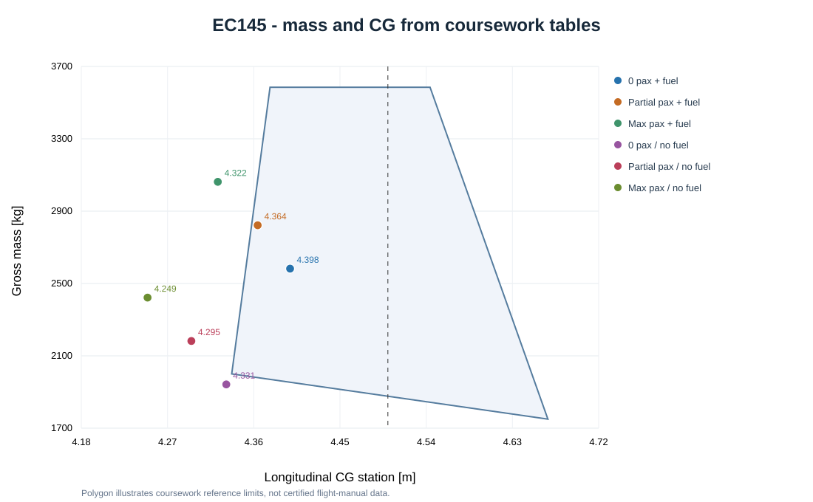
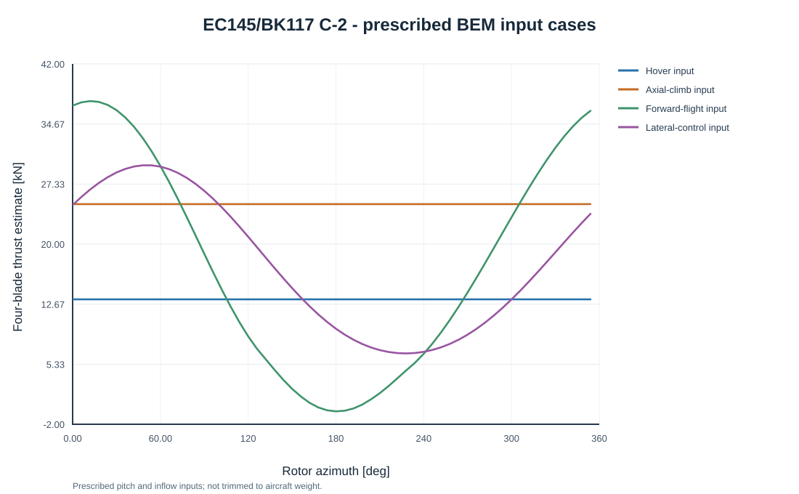
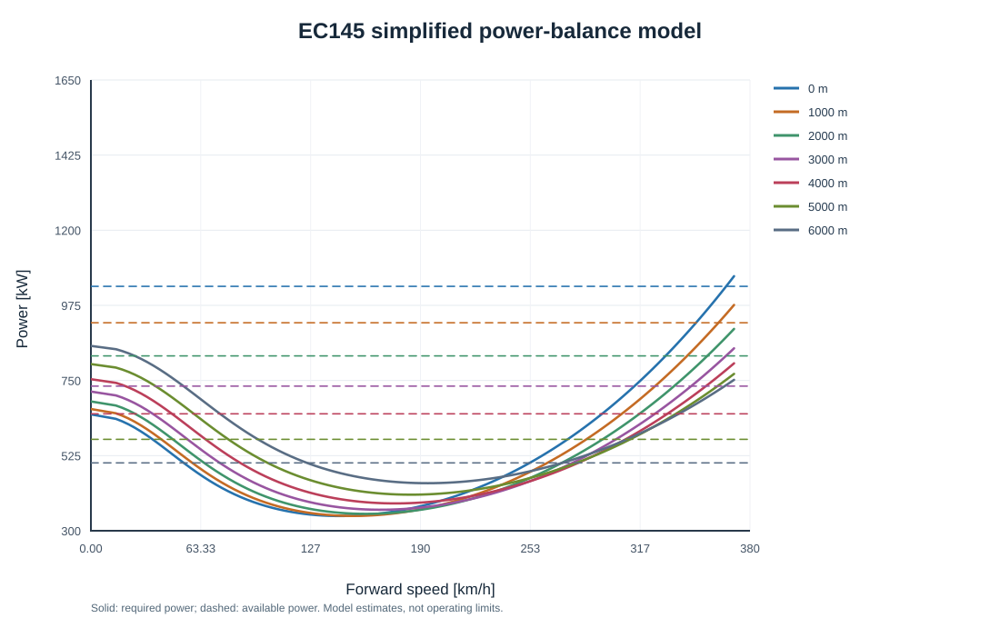
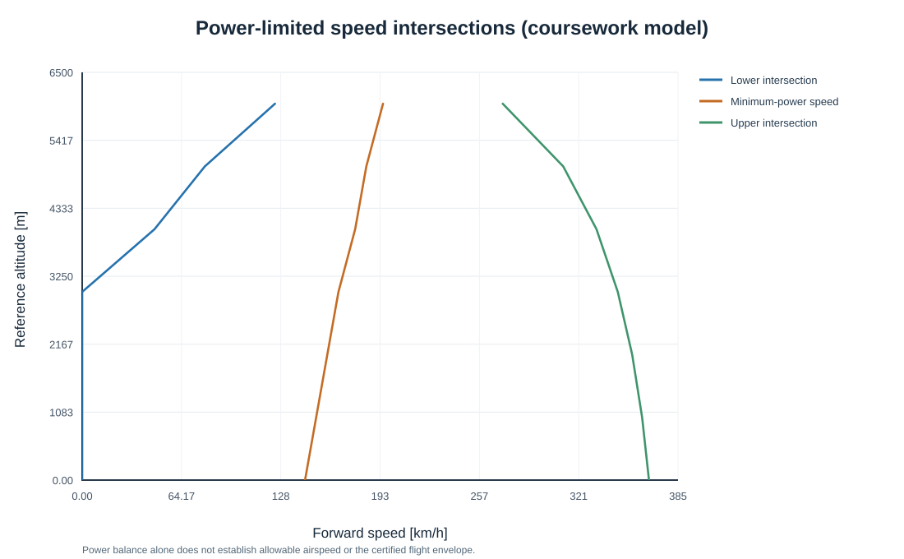
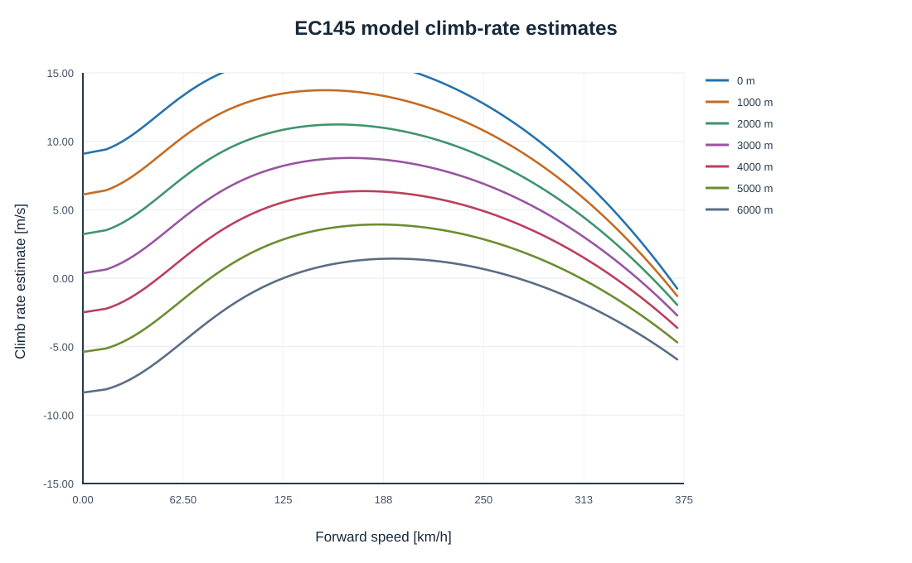
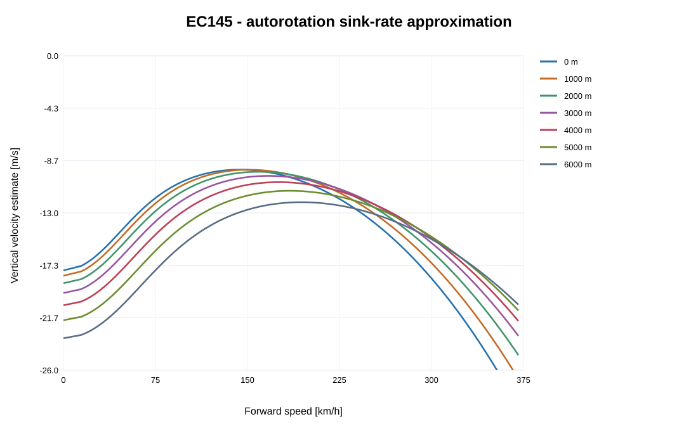
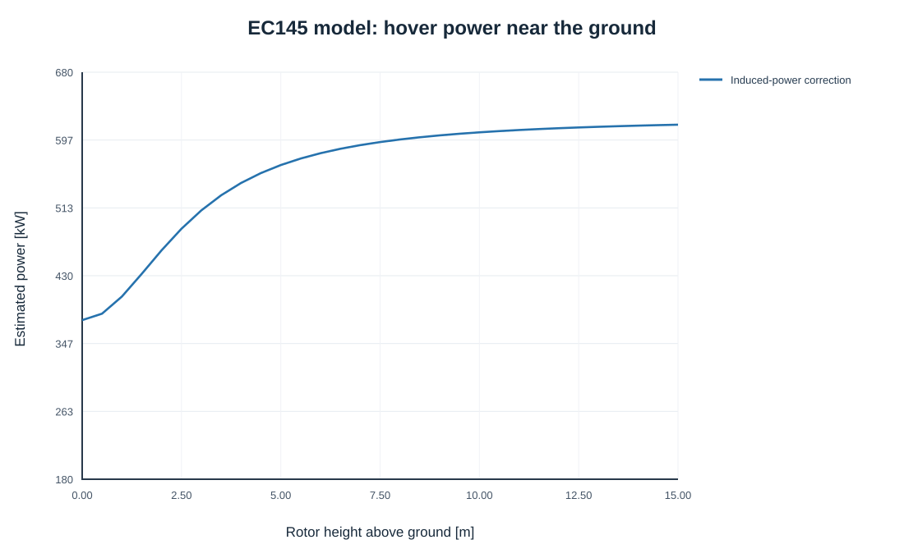
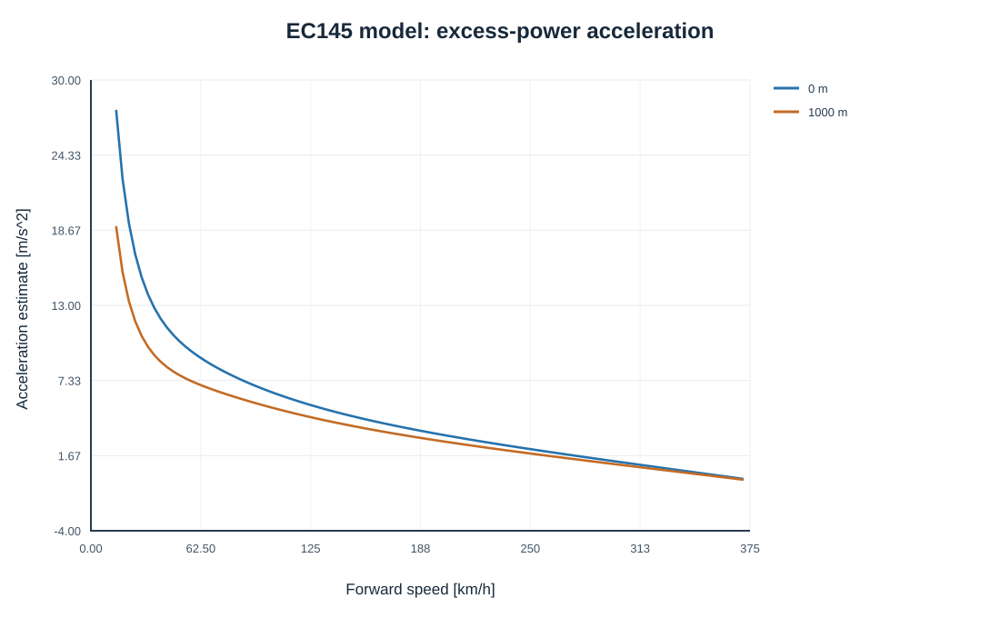

# EC145 / BK117 C-2 — Rotor Aerodynamics and Flight Performance

This repository contains selected MATLAB analyses from a larger university project on the Eurocopter EC145 (BK117 C-2). I developed the numerical work during the **Helicopters** course at the Faculty of Aerospace Engineering, National University of Science and Technology POLITEHNICA Bucharest.

The full coursework covered the helicopter's configuration, mass and balance, rotor aerodynamics, and flight performance. The three scripts shared here focus on the computational part. The university report includes additional derivations, figures, and discussion.

## Reference model

The study uses a common reference aircraft, with some parameters chosen separately for the BEM and performance exercises.

| Parameter | Coursework value |
| :--- | :--- |
| Reference maximum takeoff mass | 3,585 kg |
| Empty mass for CG calculations | 1,792 kg |
| Main rotor radius | 5.50 m |
| Main rotor blades | 4 |
| Rotor speed | 395 rpm (BEM); 383 rpm (performance) |
| Mean blade chord | 0.30 m (BEM); 0.32 m (performance) |
| Reference air density | 1.225 kg/m³ |
| Available engine power assumed at sea level | 1,032 kW total |
| Equivalent parasite-drag area | 1.20 m² |

These are the parameters adopted for the coursework models, rather than a complete set of approved flight-manual data.

## MATLAB files

| File | What it does |
| :--- | :--- |
| [ec145_weight_and_balance.m](ec145_weight_and_balance.m) | Calculates six loading cases from masses and longitudinal arms, then plots their CG positions against the coursework reference polygon |
| [ec145_bem_rotor_aerodynamics.m](ec145_bem_rotor_aerodynamics.m) | Computes rotor thrust, torque, and power for four prescribed blade-pitch and flight conditions |
| [ec145_flight_performance.m](ec145_flight_performance.m) | Estimates required/available power, power-limited speed intersections, climb, autorotation, and ground effect |

The scripts can be run independently and export vector figures to the figures directory.

## 1. Mass and balance

The university study estimates the empty-aircraft mass distribution and the longitudinal arms of major components. For any loading case, the CG follows from the mass moments:

$$
x_{\mathrm{CG}}=\frac{m_{\mathrm{empty}}x_{\mathrm{empty}}+
\sum_i m_i x_i}{m_{\mathrm{empty}}+\sum_i m_i}.
$$

The six cases have been recalculated from the component masses and stations in Tables 11–17 of the coursework report. The report's original Figure 21 used separately entered plot coordinates, so the recomputed values differ from that earlier illustration.

| Loading case | Calculated mass [kg] | CG station [m] | Inside reference polygon? |
| :--- | ---: | ---: | :---: |
| No passengers, full fuel | 2,582 | 4.398 | Yes |
| Partial passengers, full fuel | 2,822 | 4.364 | Yes |
| Maximum passengers, full fuel | 3,062 | 4.322 | No |
| No passengers, no fuel | 1,942 | 4.331 | No |
| Partial passengers, no fuel | 2,182 | 4.295 | No |
| Maximum passengers, no fuel | 2,422 | 4.249 | No |

The polygon is a **coursework reference boundary**, not a verified manufacturer CG envelope. These results illustrate the selected mass assumptions and are not an aircraft loading clearance.

  

## 2. Blade-element / momentum rotor model

The rotor is divided into 20 radial elements and evaluated at 60 unique azimuth stations. The local lift and drag estimates use blade pitch, relative velocity, and an approximate lift-curve slope; induced velocity is updated by fixed-point relaxation.

For each strip, the model resolves blade-element forces into axial force and resistive torque. The annular momentum relation includes the four-blade contribution, while azimuthal averaging gives rotor totals.

The rotor disk area is $A=\pi R^2$ and blade tip speed is $V_{\mathrm{tip}}=\Omega R$. The standard non-dimensional thrust and power coefficients are:

$$
C_T=\frac{T}{\rho A(\Omega R)^2},
\qquad
C_P=\frac{P}{\rho A(\Omega R)^3},
\qquad P=\Omega Q.
$$

Four prescribed input cases are explored: hover, axial climb, forward flight, and lateral-control flight.

  

These are **prescribed-control calculations**, not trimmed flight states. For example, the hover-input calculation gives approximately **13.25 kN** of rotor thrust, below the weight of the reference 3,585 kg helicopter. It therefore does not represent equilibrium hover at maximum takeoff mass.

## 3. Flight performance and power balance

A separate coursework model compares estimated rotor power required with available engine power at reference altitudes from sea level to 6,000 m. The power model includes induced power, blade-profile power, and an equivalent parasite-drag term.

The minimum-power speed and the lower/upper power intersections are evaluated on the same forward-speed grid used to calculate the power curves.

  
  

The model also gives approximate climb rates, autorotation sink rates, ground-effect power changes, and excess-power acceleration.

  
  
  

  

The calculated intersections indicate where the simplified power curves cross; they are **not approved operating speeds**. Rotor trim, retreating-blade stall, tip Mach effects, and control margins are outside this model. Airbus lists an EC145 C2e never-exceed speed of approximately **145 kt (269 km/h)**; a theoretical power intersection above that limit does not make it an allowable airspeed.

## Assumptions and scope

The study applies helicopter aerodynamics and flight-mechanics methods to a reference aircraft. The CG boundaries and component positions are coursework assumptions, the BEM uses prescribed pitch rather than an aircraft trim solver, and the performance calculation uses approximate altitude-dependent engine power and drag relationships.

The original university report includes numerical results from earlier versions of these calculations. This repository presents the revised MATLAB implementations and their corresponding plots, not the complete report.

## Running the scripts

Clone or download the repository, open its root directory in MATLAB, and run the scripts separately:

~~~matlab
run('ec145_weight_and_balance.m')
run('ec145_bem_rotor_aerodynamics.m')
run('ec145_flight_performance.m')
~~~

Each script prints the relevant results and exports updated figures to the figures directory.

## Academic background

I developed the MATLAB analyses presented here during the **Elicoptere (Helicopters)** course at the Faculty of Aerospace Engineering, National University of Science and Technology POLITEHNICA Bucharest.

The broader university project also covered helicopter systems, component-mass estimation, aerodynamic derivations, and flight-performance calculations.

## Full project and contact

This repository shares only the computational portion and selected results of the larger university project. If you would like more information about the full coursework report, its derivations, or a particular calculation, feel free to contact me.

**David Irinei**  
Aerospace Engineering student — POLITEHNICA Bucharest  
Email: [yrydavid@gmail.com](mailto:yrydavid@gmail.com)

### References

- EC145/BK117 C-2 university coursework, Faculty of Aerospace Engineering, POLITEHNICA Bucharest (2026).
- [NASA, The Wind and Beyond, Vol. III](https://www.nasa.gov/wp-content/uploads/2023/09/the-wind-and-beyond-tagged.pdf) — rotor thrust and power coefficient definitions.
- [Airbus Helicopters, Aircraft Directory (2025)](https://mediaassets.airbus.com/pm_38_768_768165-cvis3dgol8.pdf) — reference EC145 C2e aircraft data and speed limitations.
