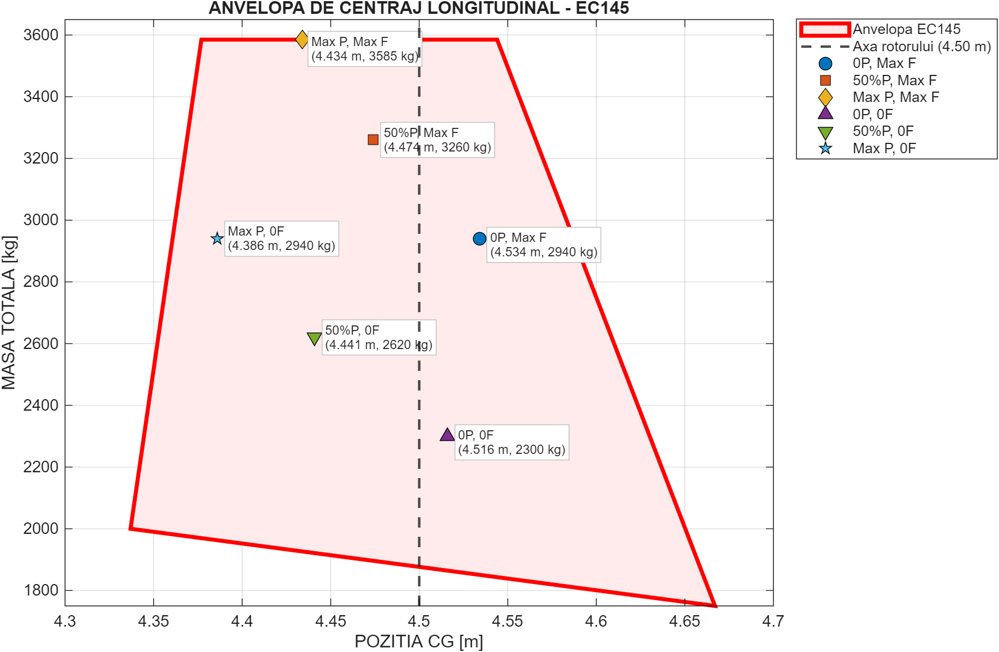
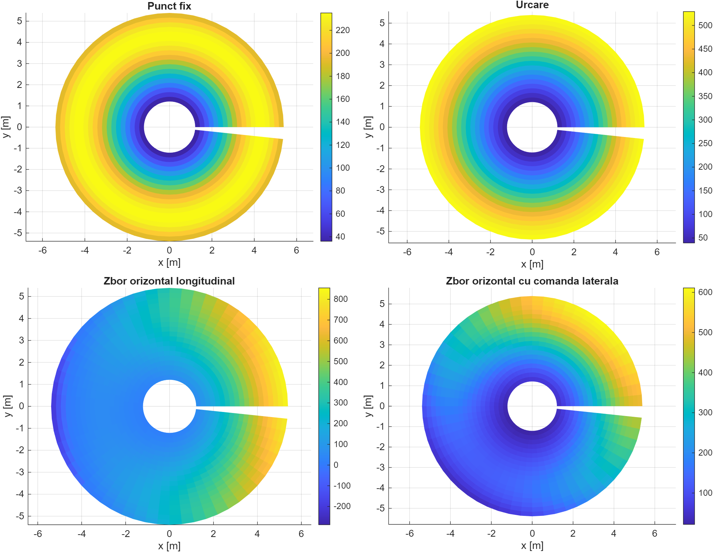
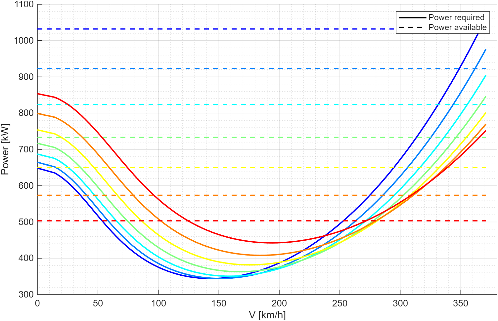
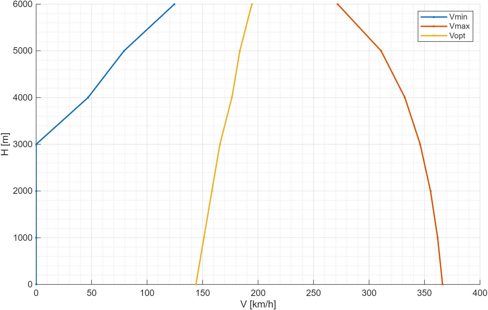
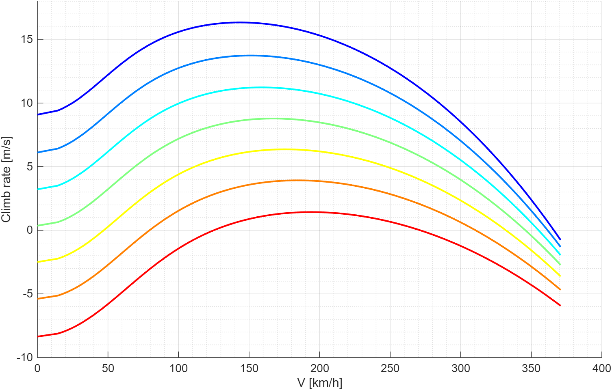
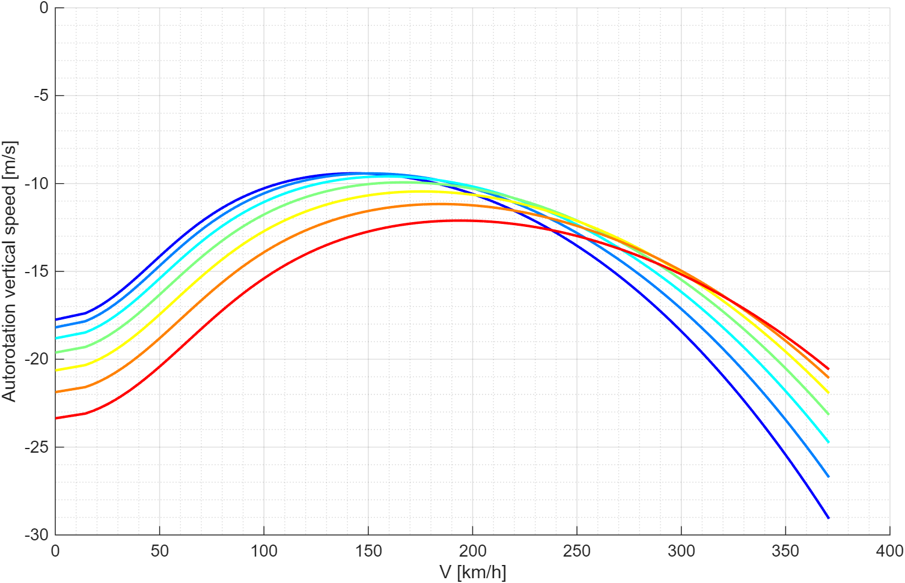
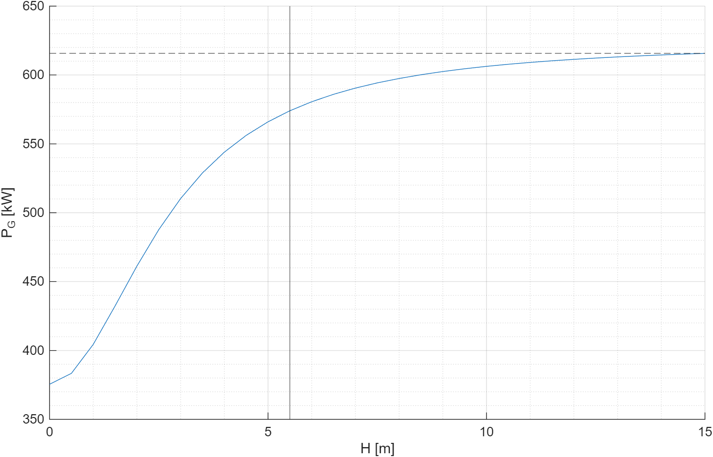
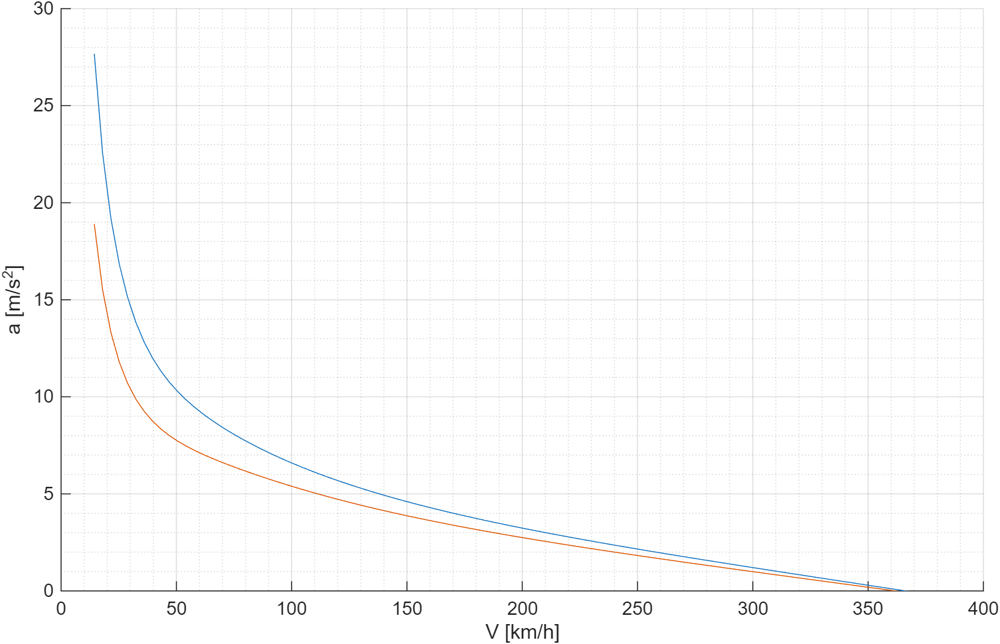

# EC145 / BK117 C-2 — Rotor Aerodynamics and Flight Performance

This repository contains MATLAB scripts developed as part of a larger university project on the Eurocopter EC145 / Kawasaki BK117 C-2 helicopter, completed during my Aerospace Engineering studies at POLITEHNICA Bucharest.

The project covers helicopter weight and balance, rotor aerodynamics using blade element momentum theory, and flight performance calculations. The MATLAB scripts focus on three areas: longitudinal centre-of-gravity analysis, aerodynamic calculations for four prescribed flight conditions, and flight performance estimates across different altitudes.

These scripts represent the computational portion of the complete university project, which also includes analytical derivations, technical specifications, additional calculations, and discussion of the results. The code published here includes a few numerical and plotting corrections made after the original course submission.

---

## Technical Specifications & Reference Helicopter

The following reference values were used in the university calculations for the twin-engine EC145 / BK117 C-2:

| Parameter | Symbol | Nominal Value | Unit |
| :--- | :---: | :---: | :---: |
| Maximum Takeoff Mass | $m_{\text{MTOW}}$ | 3585 | $\text{kg}$ |
| Empty Mass | $m_{\text{empty}}$ | 1792 | $\text{kg}$ |
| Main Rotor Radius | $R_B$ | 5.50 | $\text{m}$ |
| Blade Mean Chord | $c_b$ | 0.32 for performance / 0.30 for rotor analysis | $\text{m}$ |
| Rotor Rotational Speed | $N_R$ | 383 – 395 | $\text{RPM}$ |
| Number of Main Rotor Blades | $N_b$ | 4 | $-$ |
| Rotor Mast Longitudinal Station | $x_{\text{mast}}$ | 4.50 | $\text{m}$ |
| Installed Max Continuous Power (MCP, SL) | $P_{0,\text{max}}$ | 1032 | $\text{kW}$ |
| Equivalent Parasite Drag Area | $f_A$ | 1.20 | $\text{m}^2$ |

---

## Repository Structure

| File / Directory | Module & Technical Description |
| :--- | :--- |
| `ec145_weight_and_balance.m` | Longitudinal centre-of-gravity diagram for six coursework loading scenarios |
| `ec145_bem_rotor_aerodynamics.m` | Rotor aerodynamic calculations for four prescribed flight conditions |
| `ec145_flight_performance.m` | Power balance, climb, autorotation and ground-effect calculations |
| `figures/` | MATLAB plots illustrating the coursework calculations |
| `README.md` | Project overview, equations and selected results |
---

## 1. Weight & Balance: Longitudinal Center of Gravity Envelope

### Formulation
The complete university report estimates the longitudinal centre of gravity by summing component mass moments about the chosen datum:

$$
\displaystyle x_{\mathrm{CG}} =
\dfrac{m_{\mathrm{empty}}\,x_{\mathrm{empty}}+\sum_i m_i x_i}
      {m_{\mathrm{empty}}+\sum_i m_i}
$$

The MATLAB script reproduces the six loading points and four boundary vertices used in the original coursework figure. This is a course reference diagram, not an independently verified manufacturer loading envelope:
* **Point A:** $(4.377\text{ m}, 3585\text{ kg})$
* **Point B:** $(4.544\text{ m}, 3585\text{ kg})$
* **Point C:** $(4.667\text{ m}, 1750\text{ kg})$
* **Point D:** $(4.337\text{ m}, 2000\text{ kg})$

### Operational Loading Scenarios
The script plots the following prescribed loading configurations; the underlying mass and moment calculations are documented in the complete report:

| Scenario ID | Payload Configuration | Fuel State | Mass [kg] | CG Position [m] | Plot position |
| :--- | :--- | :--- | :---: | :---: | :---: |
| **Max P, Max F** | 8 Pax + Pilot + Baggage | 100% ($640\text{ kg}$) | **3585** | **4.434** | **Upper boundary** |
| **50% P, Max F** | 4 Pax + Pilot + Baggage | 100% ($640\text{ kg}$) | **3260** | **4.474** | **Inside** |
| **0 P, Max F** | Pilot Only + Baggage | 100% ($640\text{ kg}$) | **2940** | **4.534** | **Inside** |
| **Max P, 0 F** | 8 Pax + Pilot + Baggage | No fuel ($0\text{ kg}$) | **2940** | **4.386** | **Inside** |
| **50% P, 0 F** | 4 Pax + Pilot + Baggage | No fuel ($0\text{ kg}$) | **2620** | **4.441** | **Inside** |
| **0 P, 0 F** | Pilot Only + Baggage | No fuel ($0\text{ kg}$) | **2300** | **4.516** | **Inside** |

<p align="center">
  
</p>

---

## 2. Rotor Aerodynamics

The script combines blade-element force calculations with an approximate annular momentum balance. The four prescribed pitch and flight cases use 20 radial elements and 60 distinct azimuth stations; results are averaged over azimuth and combined across the four blades.

### Velocity Components & Local Aerodynamics
For any blade station at radial coordinate $r$ and azimuth $\psi$:

$$V_0(r,\psi) = V_I(r,\psi) + V_c + U \sin\alpha_T$$

$$V_2(r,\psi) = \Omega r + U \cos\alpha_T \sin\psi$$

$$V_1(r,\psi) = \sqrt{V_0^2 + V_2^2}, \quad \phi = \arctan\left(\frac{V_0}{V_2}\right)$$

The effective angle of attack accounts for blade cyclic pitch, linear pre-twist, and induced inflow angle:

$$\alpha_{\text{eff}}(r,\psi) = \theta_{\text{pitch}}(\psi) + \theta_{\text{twist}}(r) - \phi(r,\psi)$$

$$\theta_{\text{twist}}(r) = \theta_0 - \theta_{\text{tw}} \cdot r$$

$$\theta_{\text{pitch}}(\psi) = C + A \cos\psi + B \sin\psi$$

### Iterative Relaxation Loop
Induced velocity $V_I$ is iteratively solved using fixed-point relaxation:

$$
\displaystyle V_{I,\mathrm{new}} =
\dfrac{N_b\,dT}{4\pi\rho r V_0\,dR},
\qquad
V_I^{(k+1)}=0.9\,V_I^{(k)}+0.1\,V_{I,\mathrm{new}}
$$

Elemental thrust and resistive torque use the force components normal and tangential to the rotor disk:

$dT=dL\cos\phi-dD\sin\phi,\qquad dQ=r(dL\sin\phi+dD\cos\phi)$

The rotor-level thrust and power coefficients are $C_T=T/(\rho A V_T^2)$ and $C_P=P/(\rho A V_T^3)$, where $A=\pi R_B^2$ and $P=\Omega Q$. These calculations use prescribed inputs; no rotor trim procedure is performed.

### Evaluated Flight Regimes
The script evaluates four prescribed flight conditions:
1. **Hover (Punct fix):** $V_c = 0$, $U = 0$, $\alpha_T = 0^\circ$
2. **Axial Climb (Urcare):** $V_c = 5\text{ m/s}$, $U = 0$, $\alpha_T = 0^\circ$
3. **Forward Flight (Zbor orizontal longitudinal):** $V_c = 0$, $U = 10\text{ m/s}$, $\alpha_T = 5^\circ$
4. **Lateral Control Flight (Comandă laterală):** $V_c = 0$, $U = 5\text{ m/s}$, $\alpha_T = 2^\circ$

<p align="center">
  
</p>

---

## 3. Flight Performance and Power Balance

### Power Required vs. Power Available
Total required power in horizontal flight balances induced power, blade profile drag, and fuselage parasitic drag:

$$P_{\text{req}} = (1 + k_{\text{res}}) \left[ k_f \lambda_i C_T + \frac{\sigma}{8} C_{D0} (1 + K \mu^2) + \mu \frac{R_D}{mg} C_T \right] \rho \pi R_B^2 V_T^3$$

The non-dimensional induced inflow ratio $\lambda_i = r_k \sqrt{C_T/2}$ is solved at each velocity via the quartic Glauert inflow equation:

$$p(r) = r^4 + \left(\frac{V}{V_T \sqrt{C_T/2}}\right)^2 r^2 - 1 = 0$$

Available engine power variation with altitude $H$ is computed for the twin-turboshaft powerplant:

$$P_{\text{AV}}(H) = P_{0,\text{max}} \left[ 1.11 \left(\frac{\rho(H)}{\rho_0}\right) - 0.11 \right], \quad \rho(H) = \rho_0 \frac{20000 - H}{20000 + H}$$

<p align="center">
  
  
</p>

### Additional Performance Estimates
* **Vertical Climb Rate ($w_c$):**

$$w_c = V_T \left[ \frac{(1 - k_{\text{res}}) C_{P,\text{AV}}}{\xi C_T} - \frac{k_f \lambda_i}{\xi} - \frac{\sigma C_{D0}}{8 \xi C_T}(1 + K\mu^2) - \frac{\mu^3 f_A}{2 \xi C_T \pi R_B^2} \right]$$

* **Autorotation Sink Rate ($w_{\text{aut}}$):** An approximate zero-engine-power descent estimate within the coursework model.
* **Ground Effect (IGE):** Power reduction modeled as a function of rotor height above terrain $H_G$:

$$\xi_G = 1 - \frac{0.5}{1 + 4 \left(H_G / R_B\right)^2}$$

<p align="center">
  
  
  
</p>

<p align="center">
  
</p>

---

## Flight Performance Results

The table summarizes estimates from the power-balance model with the forward-speed grid aligned to the corresponding power calculations. The upper power intersection is a mathematical result of this simplified model, **not** the helicopter's permitted maximum operating speed.

| Altitude [m] | Lower power intersection [km/h] | Minimum-power speed [km/h] | Upper power intersection [km/h] | Maximum model climb rate [m/s] | Least-negative model sink rate [m/s] |
| :---: | ---: | ---: | ---: | ---: | ---: |
| 0 | 0.00 | 144.00 | 366.24 | 16.33 | −9.42 |
| 1000 | 0.00 | 151.20 | 361.81 | 13.73 | −9.42 |
| 2000 | 0.00 | 158.40 | 355.39 | 11.23 | −9.59 |
| 3000 | 0.00 | 165.60 | 346.09 | 8.78 | −9.93 |
| 4000 | 46.77 | 176.40 | 332.32 | 6.36 | −10.45 |
| 5000 | 79.22 | 183.60 | 310.85 | 3.92 | −11.17 |
| 6000 | 124.59 | 194.40 | 271.74 | 1.43 | −12.11 |

The numerical values differ slightly from the table in the original university report because the speed indexing has been corrected. The complete report preserves the results as originally submitted.

---

## How to Run

1. Clone the repository:
```bash
git clone https://github.com/yrydavid/EC145-Rotorcraft-Aerodynamics-Flight-Performance.git
cd EC145-Rotorcraft-Aerodynamics-Flight-Performance
```

2. Open MATLAB with this repository as the current working directory.

3. Run the analysis scripts individually. The scripts export PNG figures into `figures/`:
```matlab
run('ec145_weight_and_balance.m');       % CG envelope & loading configurations
run('ec145_bem_rotor_aerodynamics.m');   % Rotor aerodynamic distributions
run('ec145_flight_performance.m');       % Power required/available & flight ceilings
```

---

## Academic Context

This project was developed during the *Elicoptere (Helicopters)* course at the Faculty of Aerospace Engineering, National University of Science and Technology POLITEHNICA Bucharest, as part of my Aerospace Engineering studies.

The coursework involved applying theoretical and numerical methods to helicopter aerodynamics, mass and balance, and flight performance, using the EC145 / BK117 C-2 as the reference aircraft.

---

## Full Project and Contact

This repository contains selected MATLAB scripts and figures from the complete university project. The GitHub code includes a few corrections made after the classroom submission; the original report, analytical derivations and further technical discussion remain available on request.

If you are interested in the complete project or would like further details about the methodology and results, feel free to contact me.

**David Irinei**  
Aerospace Engineering Student  
National University of Science and Technology POLITEHNICA Bucharest  
Email: [yrydavid@gmail.com](mailto:yrydavid@gmail.com)
