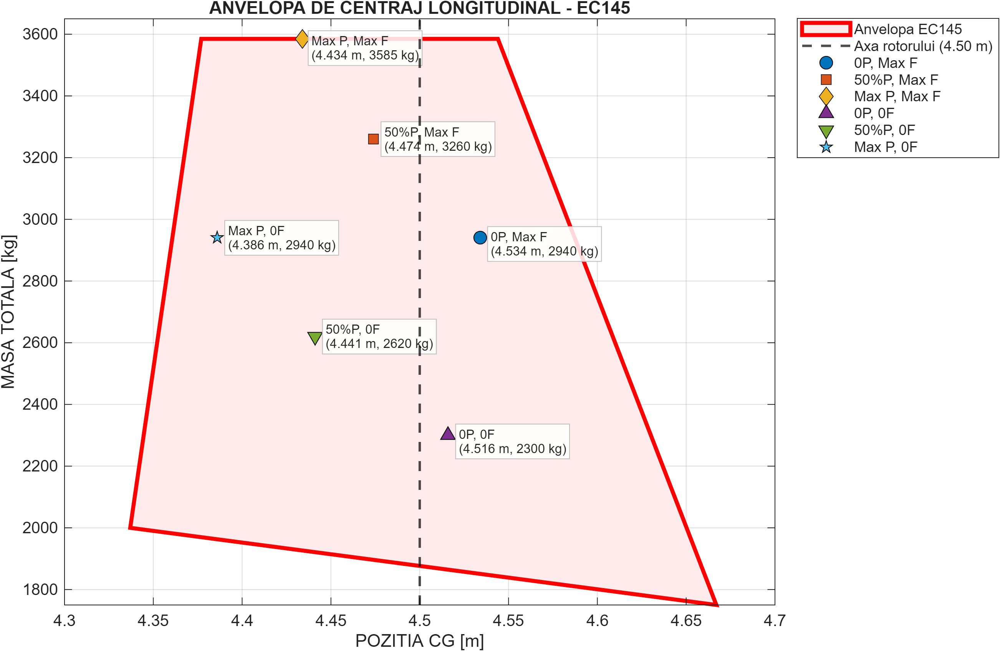
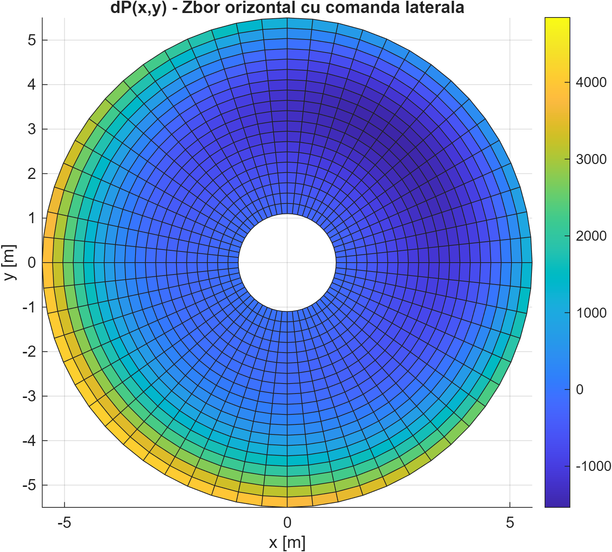
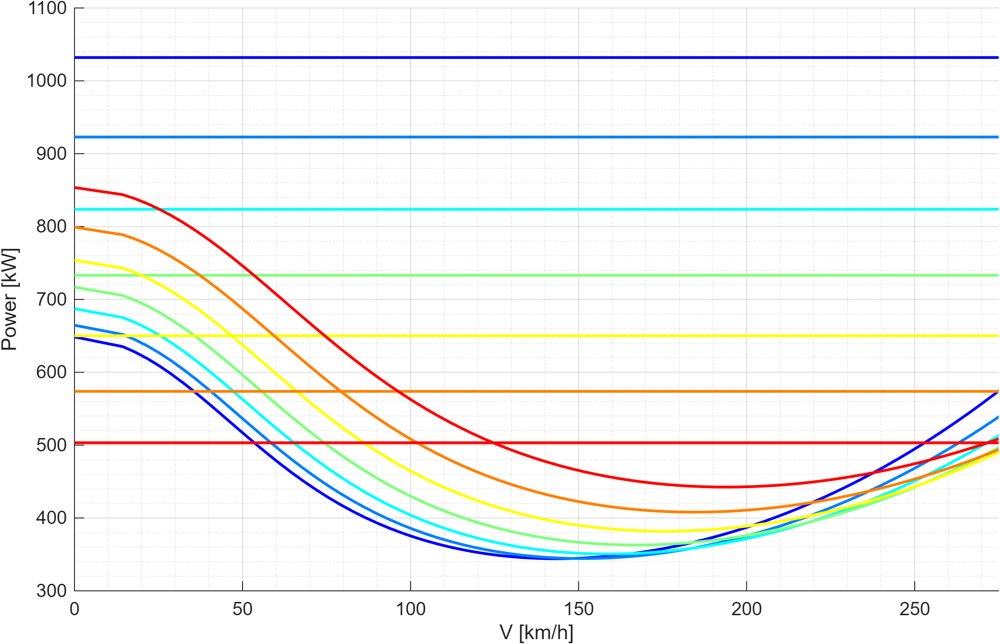
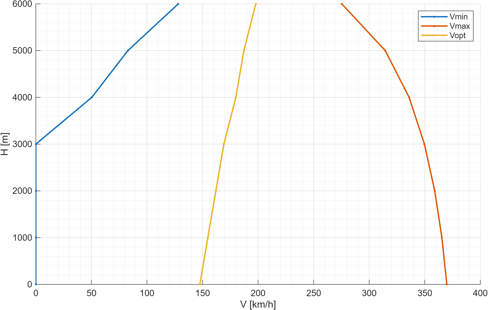
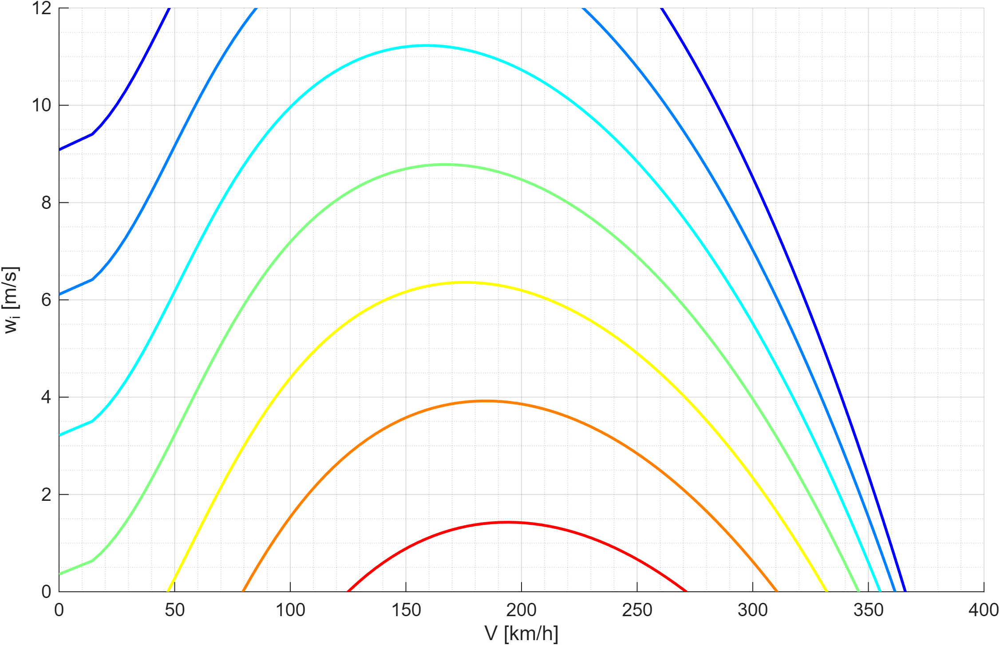
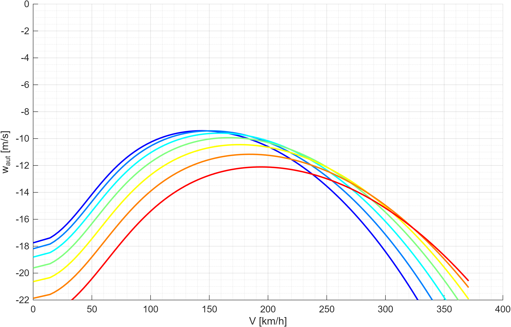
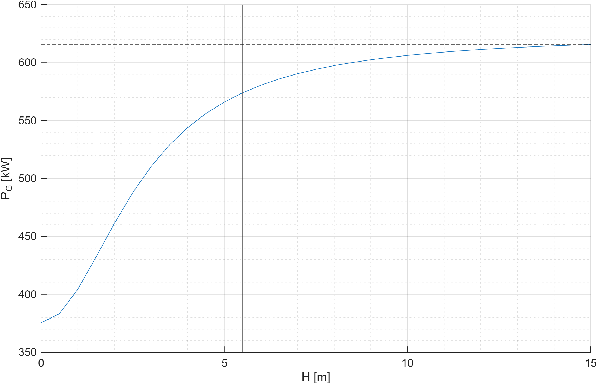

# EC145-Rotorcraft-Aerodynamics-Flight-Performance
# EC145 / BK117 C-2: Rotor Aerodynamics, Stability & Flight Performance Framework

An end-to-end computational flight mechanics framework developed in **MATLAB** for the **Airbus Helicopters EC145 (Kawasaki BK117 C-2)** twin-engine light utility helicopter.

The suite models the full aerodynamic and operational flight envelope:
1. **Weight & Balance & Longitudinal Center of Gravity (CG) Envelope Verification** across 6 operational configurations.
2. **2D/3D Blade Element Momentum (BEM) Aerodynamic Solver** with cyclic pitch/flapping dynamics and non-linear induced inflow iterative relaxation across 4 flight conditions.
3. **Comprehensive Flight Performance & Power Balance Engine** evaluating level forward flight, vertical climb capabilities, autorotation sink rates, and ground effect (IGE/OGE) up to service ceiling altitudes ($H = 0 \text{ to } 6000\text{ m}$).

---

## Technical Specifications & Reference Helicopter

The reference parameters modeled reflect the EC145 / BK117 C-2 certification baseline powered by two Turbomeca Arriel 1E2 turboshaft engines:

| Parameter | Symbol | Nominal Value | Unit |
| :--- | :---: | :---: | :---: |
| Maximum Takeoff Weight (MTOW) | $m_{\text{MTOW}}$ | 3585 | $\text{kg}$ |
| Empty Weight | $m_{\text{empty}}$ | 1792 | $\text{kg}$ |
| Main Rotor Radius | $R_B$ | 5.50 | $\text{m}$ |
| Blade Mean Chord | $c_b$ | 0.32 (Perf) / 0.30 (BEM) | $\text{m}$ |
| Rotor Rotational Speed | $N_R$ | 383 – 395 | $\text{RPM}$ |
| Number of Main Rotor Blades | $N_b$ | 4 | $-$ |
| Rotor Mast Longitudinal Station | $x_{\text{mast}}$ | 4.50 | $\text{m}$ |
| Installed Max Continuous Power (MCP, SL) | $P_{0,\text{max}}$ | 1032 | $\text{kW}$ |
| Equivalent Parasite Drag Area | $f_A$ | 1.20 | $\text{m}^2$ |

---

## Repository Structure

├── ec145_weight_and_balance.m      # Module 1: Longitudinal CG envelope & loading scenarios
├── ec145_bem_rotor_aerodynamics.m  # Module 2: Blade Element Momentum (BEM) multi-regime solver
├── ec145_flight_performance.m      # Module 3: Power balance, ceilings & operational envelope
├── figures/                        # Generated figures and visual validation plots
│   ├── cg_envelope.png
│   ├── power_required_available.png
│   ├── rate_of_climb.png
│   ├── autorotation_descent.png
│   ├── flight_ceiling_envelope.png
│   ├── ground_effect_power.png
│   ├── horizontal_acceleration.png
│   └── bem_thrust_distribution.png
└── README.md                       # Complete technical documentation

---

## 1. Weight & Balance: Longitudinal Center of Gravity Envelope

### Formulation
The overall center of gravity position is determined by structural moment summation relative to the forward datum:

$$x_{\text{CG}} = \frac{M_{\text{total}}}{m_{\text{total}}} = \frac{m_{\text{empty}} x_{\text{empty}} + \sum_i m_i x_i}{m_{\text{empty}} + \sum_i m_i}$$

The certified flight envelope is bounded by four critical vertices defined in the official Flight Manual:
* **Point A:** $(4.377\text{ m}, 3585\text{ kg})$
* **Point B:** $(4.544\text{ m}, 3585\text{ kg})$
* **Point C:** $(4.667\text{ m}, 1750\text{ kg})$
* **Point D:** $(4.337\text{ m}, 2000\text{ kg})$

### Operational Loading Scenarios
Six critical mission configurations were evaluated to ensure compliance within structural margins:

| Scenario ID | Payload Configuration | Fuel State | Mass [kg] | CG Position [m] | In-Envelope Status |
| :--- | :--- | :--- | :---: | :---: | :---: |
| **Max P, Max F** | 8 Pax + Pilot + Baggage | 100% ($640\text{ kg}$) | **3585** | **4.434** | **COMPLIANT** |
| **50% P, Max F** | 4 Pax + Pilot + Baggage | 100% ($640\text{ kg}$) | **3260** | **4.474** | **COMPLIANT** |
| **0 P, Max F** | Pilot Only + Baggage | 100% ($640\text{ kg}$) | **2940** | **4.534** | **COMPLIANT** |
| **Max P, 0 F** | 8 Pax + Pilot + Baggage | Reserve ($0\text{ kg}$) | **2940** | **4.386** | **COMPLIANT** |
| **50% P, 0 F** | 4 Pax + Pilot + Baggage | Reserve ($0\text{ kg}$) | **2620** | **4.441** | **COMPLIANT** |
| **0 P, 0 F** | Pilot Only + Baggage | Reserve ($0\text{ kg}$) | **2300** | **4.516** | **COMPLIANT** |

  

---

## 2. Rotor Aerodynamics: Blade Element Momentum (BEM) Solver

The aerodynamic environment across the rotor disk is resolved by coupling 2D blade element strip theory with momentum conservation along differential annular rings of spanwise width $dR$.

### Velocity Components & Local Aerodynamics
For any blade station at radial coordinate $r$ and azimuth $\psi$:

$$V_0(r,\psi) = V_I(r,\psi) + V_c + U \sin\alpha_T$$

$$V_2(r,\psi) = \Omega r + U \cos\alpha_T \sin\psi$$

$$V_1(r,\psi) = \sqrt{V_0^2 + V_2^2}, \quad \phi = \arctan\left(\frac{V_0}{V_2}\right)$$

The effective angle of attack accounts for blade cyclic pitch, linear pre-twist, and induced inflow angle:

$$\alpha_{\text{eff}}(r,\psi) = \theta_{\text{pitch}}(\psi) + \theta_{\text{twist}}(r) - \phi(r,\psi)$$

$$\theta_{\text{twist}}(r) = \theta_0 - \theta_{\text{tw}} \cdot r$$

$$\theta_{\text{pitch}}(\psi) = C + A \cos\psi + B \sin\psi$$

### Iterative Relaxation Loop
Induced velocity $V_I$ is iteratively solved using fixed-point relaxation:

$$V_{I,\text{new}} = \frac{dT}{4 \pi \rho r V_0 \, dR}, \quad V_I^{(k+1)} = 0.9 \, V_I^{(k)} + 0.1 \, V_{I,\text{new}}$$

### Evaluated Flight Regimes
The solver resolves 4 operational rotorcraft conditions:
1. **Hover (Punct fix):** $V_c = 0$, $U = 0$, $\alpha_T = 0^\circ$
2. **Axial Climb (Urcare):** $V_c = 5\text{ m/s}$, $U = 0$, $\alpha_T = 0^\circ$
3. **Forward Flight (Zbor orizontal longitudinal):** $V_c = 0$, $U = 10\text{ m/s}$, $\alpha_T = 5^\circ$
4. **Lateral Control Flight (Comandă laterală):** $V_c = 0$, $U = 5\text{ m/s}$, $\alpha_T = 2^\circ$

  

---

## 3. Flight Performance & Operational Ceiling Engine

### Power Required vs. Power Available
Total required power in horizontal flight balances induced power, blade profile drag, and fuselage parasitic drag:

$$P_{\text{req}} = (1 + k_{\text{res}}) \left[ k_f \lambda_i C_T + \frac{\sigma}{8} C_{D0} (1 + K \mu^2) + \mu \frac{R_D}{mg} C_T \right] \rho \pi R_B^2 V_T^3$$

The non-dimensional induced inflow ratio $\lambda_i = r_k \sqrt{C_T/2}$ is solved at each velocity via the quartic Glauert inflow equation:

$$p(r) = r^4 + \left(\frac{V}{V_T \sqrt{C_T/2}}\right)^2 r^2 - 1 = 0$$

Available engine power variation with altitude $H$ is computed for the twin-turboshaft powerplant:

$$P_{\text{AV}}(H) = P_{0,\text{max}} \left[ 1.11 \left(\frac{\rho(H)}{\rho_0}\right) - 0.11 \right], \quad \rho(H) = \rho_0 \frac{20000 - H}{20000 + H}$$

  
  

### Key Performance Capabilities
* **Vertical Climb Rate ($w_c$):**

$$w_c = V_T \left[ \frac{(1 - k_{\text{res}}) C_{P,\text{AV}}}{\xi C_T} - \frac{k_f \lambda_i}{\xi} - \frac{\sigma C_{D0}}{8 \xi C_T}(1 + K\mu^2) - \frac{\mu^3 f_A}{2 \xi C_T \pi R_B^2} \right]$$

* **Autorotation Sink Rate ($w_{\text{aut}}$):** Minimum descent velocity computed under total engine power failure ($P_{\text{AV}} = 0$).
* **Ground Effect (IGE):** Power reduction modeled as a function of rotor height above terrain $H_G$:

$$\xi_G = 1 - \frac{0.5}{1 + 4 \left(H_G / R_B\right)^2}$$

  
  
  

---

## Performance Summary Table

| Altitude $H$ [m] | $V_{\min}$ [km/h] | $V_{\text{opt}}$ [km/h] | $V_{\max}$ [km/h] | Max Climb $w_c$ [m/s] | Min Autorotation $w_{\text{aut}}$ [m/s] |
| :---: | :---: | :---: | :---: | :---: | :---: |
| **0 (SL)** | 0.00 | 144.00 | 258.42 | 10.45 | -8.12 |
| **1000** | 0.00 | 147.60 | 251.18 | 8.84 | -8.45 |
| **2000** | 0.00 | 151.20 | 242.80 | 7.15 | -8.82 |
| **3000** | 0.00 | 154.80 | 232.95 | 5.37 | -9.23 |
| **4000** | 0.00 | 158.40 | 220.90 | 3.48 | -9.68 |
| **5000** | 42.15 | 162.00 | 204.60 | 1.46 | -10.19 |
| **6000** | 88.30 | 165.60 | 179.20 | 0.21 | -10.77 |

---

## How to Run

1. Clone the repository:
git clone https://github.com/yrydavid/EC145-Rotorcraft-Aerodynamics-Flight-Performance.git
cd EC145-Rotorcraft-Aerodynamics-Flight-Performance

2. Open MATLAB and add the root folder to your path.
3. Run the analysis scripts individually:
run('ec145_weight_and_balance.m')      % Generates CG envelope plot
run('ec145_bem_rotor_aerodynamics.m')  % Computes multi-regime BEM distributions
run('ec145_flight_performance.m')      % Computes power balance & flight ceilings

---

## Author & Contact

**David Irinei**  
Aerospace Engineering Student – National University of Science and Technology POLITEHNICA Bucharest  
Specialization: Aerospace Construction (*Construcții Aerospațiale*)  
Email: [yrydavid@gmail.com](mailto:yrydavid@gmail.com)
